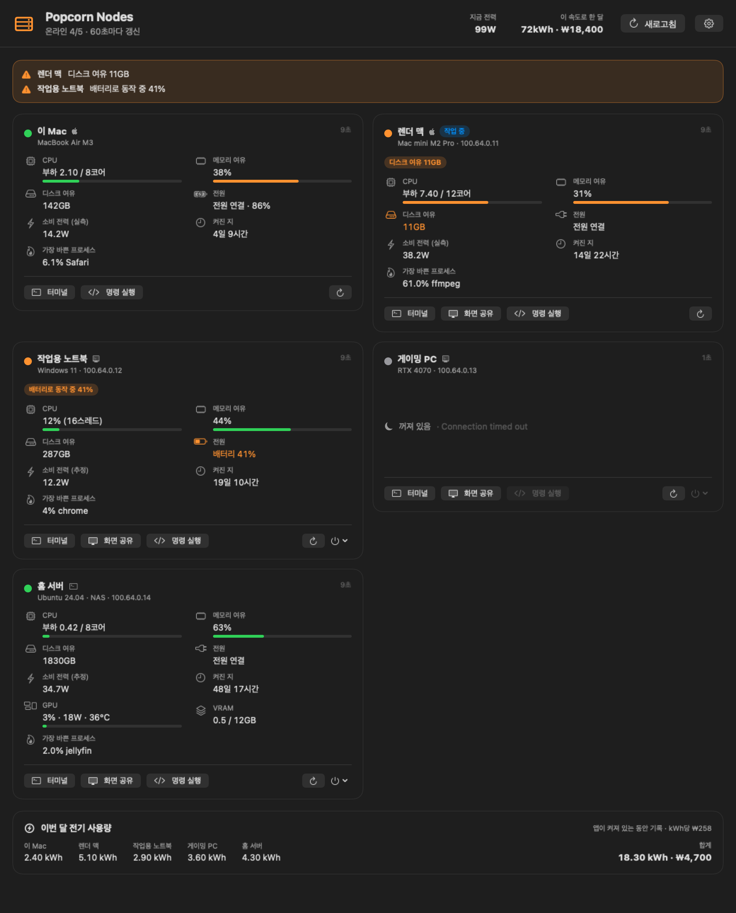
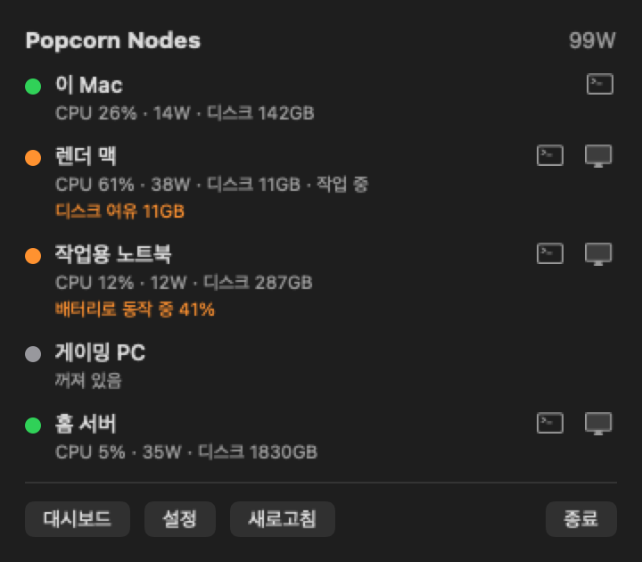
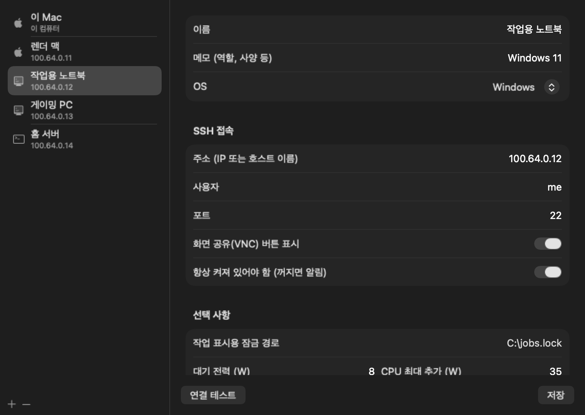

# Popcorn Nodes

**내 컴퓨터 전부를 메뉴 막대 하나로.** Mac, Windows, Linux 장비를 SSH로 한 화면에서 봅니다. 서버도, 장비에 깔 프로그램도, 계정도, 데이터 수집도 없습니다.

[English README](README.md)



## 보여 주는 것

- **상태:** 온라인 여부, CPU, 메모리·디스크 여유, 켜진 시간, 가장 바쁜 프로세스
- **전원:** 배터리·전원 연결 상태, 소비 전력 (Mac은 센서 실측, Windows·Linux는 추정, NVIDIA GPU는 `nvidia-smi` 실측)
- **전기 요금:** 앱이 켜져 있는 동안 쌓은 kWh와 내 단가 기준 이번 달 금액
- **GPU:** 사용률, 전력, 온도, VRAM
- **작업 표시:** 잠금 파일 경로를 지정하면 그 파일이 있을 때 "작업 중"으로 표시
- **알림:** 항상 켜져 있어야 하는 장비가 끊기거나, 배터리로 바뀌거나, 디스크가 부족하면 맥 알림

## 할 수 있는 것

- **터미널(SSH)**, **화면 공유(VNC)** 한 번에 열기
- 장비에서 **명령 실행** (상위 프로세스, 디스크, GPU, 서비스 오류 등 프리셋 포함)
- Windows·Linux 장비 **재시작·종료** (확인 창 후 실행)





## 설치

1. [Releases](https://github.com/team-datapopcorn/popcorn-nodes/releases)에서 최신 `.dmg`를 받아 응용 프로그램 폴더로 끌어 넣습니다.
2. 앱을 열고 **설정 → 장비 → +** 에서 이름, 주소, 사용자, OS를 넣고 **연결 테스트**를 누릅니다.

macOS 14 Sonoma 이상 (Apple 실리콘, 인텔 모두 지원).

## 장비 연결 (한 번만)

이 Mac의 SSH 키(`~/.ssh`)로 접속하므로 장비마다 키 로그인을 한 번 설정해야 합니다. 앱의 **연결 방법** 탭에 복사 버튼이 있습니다.

| 장비 | 설정 |
|---|---|
| macOS | 시스템 설정 → 일반 → 공유 → **원격 로그인** 켜기, 그다음 `ssh-copy-id user@host` |
| Windows 10/11 | 관리자 PowerShell에서 `Add-WindowsCapability -Online -Name OpenSSH.Server~~~~0.0.1.0; Start-Service sshd; Set-Service sshd -StartupType Automatic`, 공개 키는 관리자 계정이면 `C:\ProgramData\ssh\administrators_authorized_keys`, 일반 계정이면 `%USERPROFILE%\.ssh\authorized_keys` |
| Linux | `sudo apt install openssh-server` 후 `ssh-copy-id user@host` |

집 밖에서도 보려면 [Tailscale](https://tailscale.com) 같은 VPN을 쓰세요. SSH 포트를 인터넷에 직접 열지 마세요.

## 개인정보와 보안

- 모든 동작은 내 Mac에서만 일어납니다. 앱이 연결하는 곳은 내가 추가한 장비(SSH)와, 실행 시 한 번 업데이트 확인용 GitHub Releases API뿐입니다.
- 기본 동작은 읽기 전용 조회입니다. 재시작·종료·직접 입력한 명령은 버튼을 눌렀을 때만 실행됩니다.
- 설정 파일: `~/Library/Application Support/PopcornNodes/nodes.json`

## 직접 빌드

```bash
git clone https://github.com/team-datapopcorn/popcorn-nodes.git
cd popcorn-nodes
./build.sh
```

Xcode 커맨드라인 도구만 있으면 됩니다(외부 의존성 없음).

## 라이선스

MIT © [데이터팝콘](https://datapopcorn.ai)
