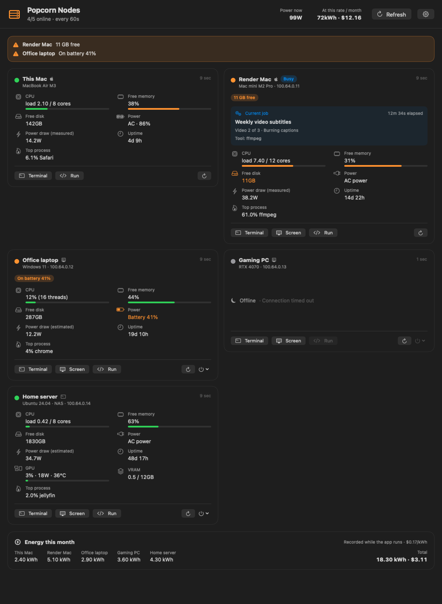
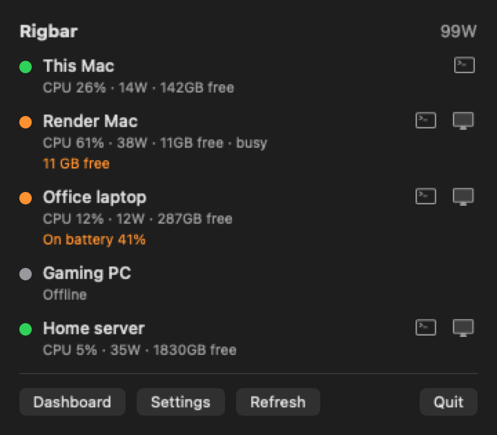
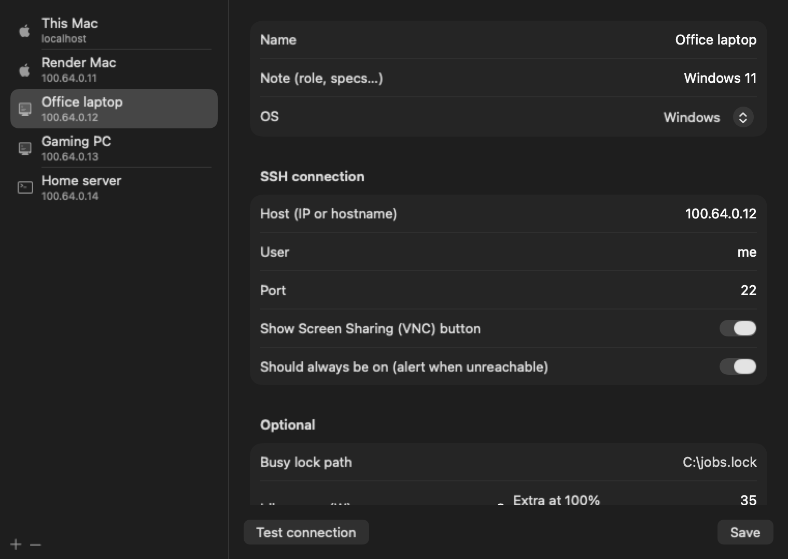
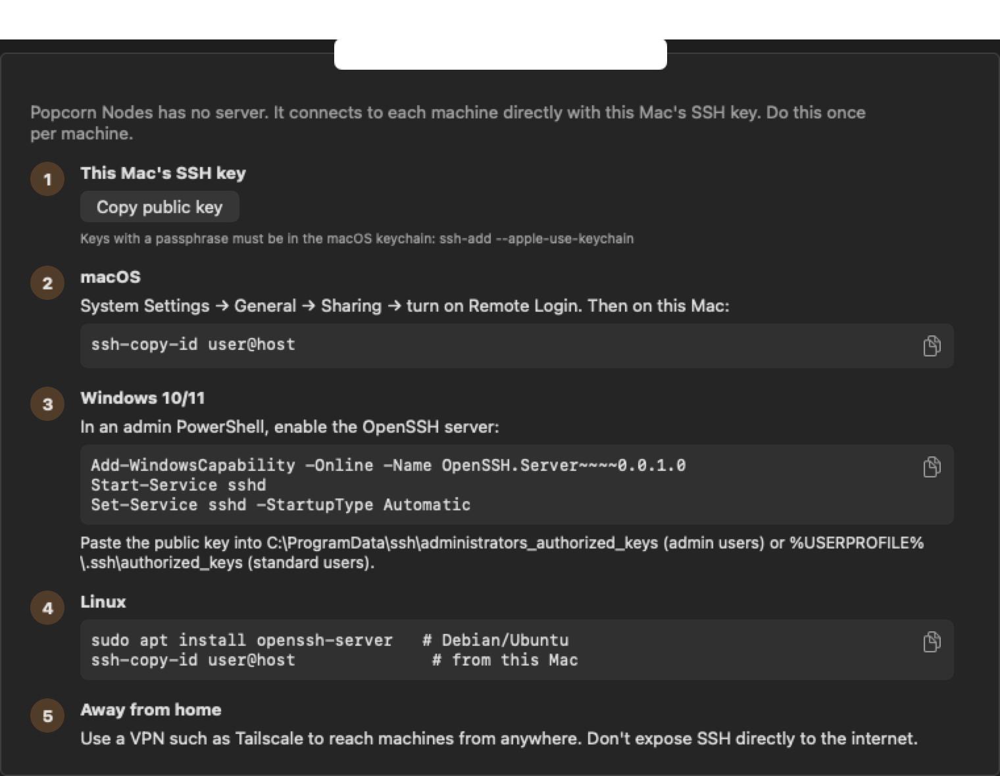

# Popcorn Nodes

**A tiny menu bar dashboard for every computer you own.** Macs, Windows PCs and Linux boxes, all on one screen, over plain SSH. No server, no agent to install, no account, no telemetry.

[한국어 README](README.ko.md)



## What it shows

- **Status at a glance:** online/offline, CPU, free memory, free disk, uptime, the busiest process
- **Power:** battery and AC state, power draw (measured on Macs via the SMC, estimated on Windows/Linux, NVIDIA GPU power measured with `nvidia-smi`)
- **Energy bill:** kWh recorded while the app runs and the monthly cost at your rate
- **GPU:** utilisation, power, temperature, VRAM
- **Busy flag:** point it at a lock file (e.g. a render job's lock) and the card shows "Busy"
- **Alerts:** macOS notifications when an always-on machine drops off, switches to battery, or runs low on disk

## What you can do

- Open an SSH **Terminal** or **Screen Sharing** (VNC) in one click
- **Run a command** on any machine with handy presets (top processes, disk, GPU, failed services…)
- **Restart / shut down** Windows and Linux machines (with a confirmation)







## Install

1. Download `PopcornNodes-<version>.zip` from [Releases](https://github.com/team-datapopcorn/popcorn-nodes/releases/latest), unzip it and move **Popcorn Nodes** to Applications.
2. The current release is ad-hoc signed, not yet notarized by Apple. The first launch shows "Apple could not verify…". Open **System Settings → Privacy & Security**, scroll down and click **Open Anyway** (or run `xattr -dr com.apple.quarantine "/Applications/Popcorn Nodes.app"`). You only do this once. A notarized DMG and a Homebrew cask will follow.
3. Open it, then **Settings → Machines → +** to add a machine (name, host, user, OS) and press **Test connection**.

Prefer to build it yourself? See [Build from source](#build-from-source). It takes about a minute with the Xcode command line tools.

Requires macOS 14 Sonoma or later (Apple silicon and Intel).

## Connecting machines

Popcorn Nodes uses your Mac's existing SSH key (`~/.ssh`) in non-interactive mode, so each machine needs key-based login once. The in-app **Setup guide** tab has copy buttons for all of this.

| Machine | One-time setup |
|---|---|
| macOS | System Settings → General → Sharing → **Remote Login** on, then `ssh-copy-id user@host` |
| Windows 10/11 | Admin PowerShell: `Add-WindowsCapability -Online -Name OpenSSH.Server~~~~0.0.1.0; Start-Service sshd; Set-Service sshd -StartupType Automatic`, then add your public key to `C:\ProgramData\ssh\administrators_authorized_keys` (admins) or `%USERPROFILE%\.ssh\authorized_keys` |
| Linux | `sudo apt install openssh-server` (or your distro's equivalent), then `ssh-copy-id user@host` |

Away from home? Use a mesh VPN such as [Tailscale](https://tailscale.com). Don't expose SSH to the internet.

Keys protected by a passphrase must be loaded into the macOS keychain (`ssh-add --apple-use-keychain`).

## Privacy & security

- Everything runs locally. The app talks only to the machines you add (over SSH) and, once at launch, to the GitHub Releases API to check for updates.
- Read-only probes by default. Restart/shutdown and custom commands only run when you click them.
- Config lives in `~/Library/Application Support/PopcornNodes/nodes.json`.

## Build from source

```bash
git clone https://github.com/team-datapopcorn/popcorn-nodes.git
cd popcorn-nodes
./build.sh            # universal build, ad-hoc signed, installs to ~/Applications
```

Only Xcode command line tools are needed (no Xcode project, no dependencies). `./scripts/release.sh` produces a Developer ID signed, notarized DMG.

Handy flags on the binary: `--probe` prints every machine's raw status, `--snapshot out.png [--demo]` renders the dashboard to an image.

## How power is measured

| | Source |
|---|---|
| Mac | `ioreg AppleSmartBattery` → `SystemPowerIn` (wall power) or `SystemLoad` (on battery) |
| Windows | idle W + CPU% × extra W (set per machine) + NVIDIA GPU power |
| Linux | battery `power_now` when on battery, otherwise the same estimate as Windows |

Estimates are labelled as such in the UI. A smart plug is still the ground truth.

## License

MIT © DataPopcorn. Made in Seoul by [DataPopcorn](https://datapopcorn.ai).

### Current job details

A lock directory can optionally contain UTF-8 files `name`, `stage`, `tool`, `started` (Unix epoch seconds) and `workdir`. The card shows the task name, reported stage, tool and elapsed time. Only the lock owner should write or clean these files. Never store full commands, arguments or credentials. Only the last component of the work directory is displayed. Legacy empty locks remain supported, with detected folders explicitly distinguished from reported task names. Details follow the configured refresh interval; no progress or stage is fabricated.

Run model regression checks with `scripts/test-job-model.sh`.
